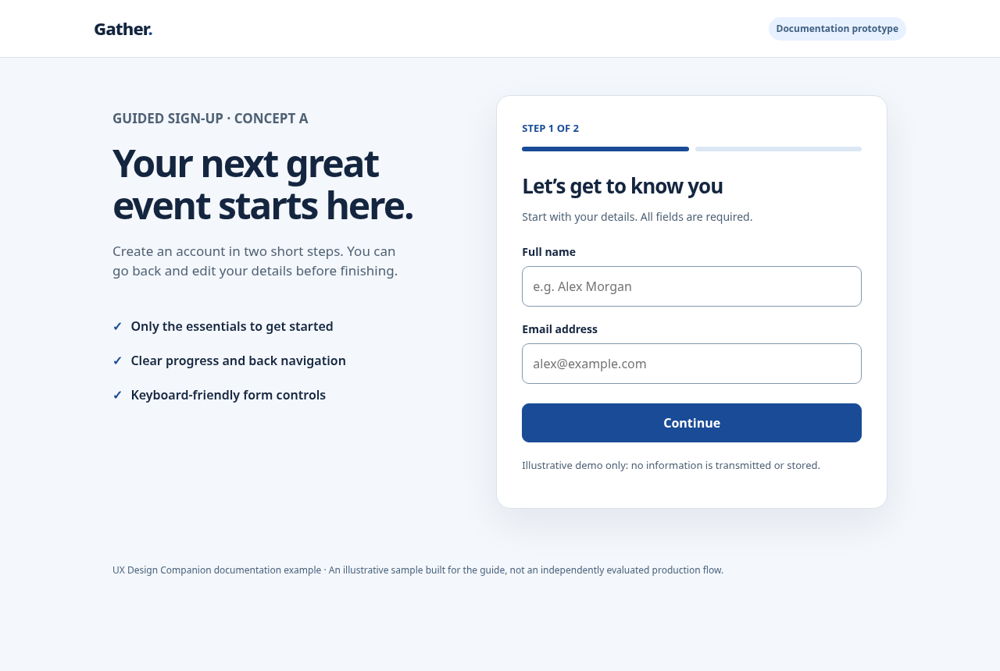
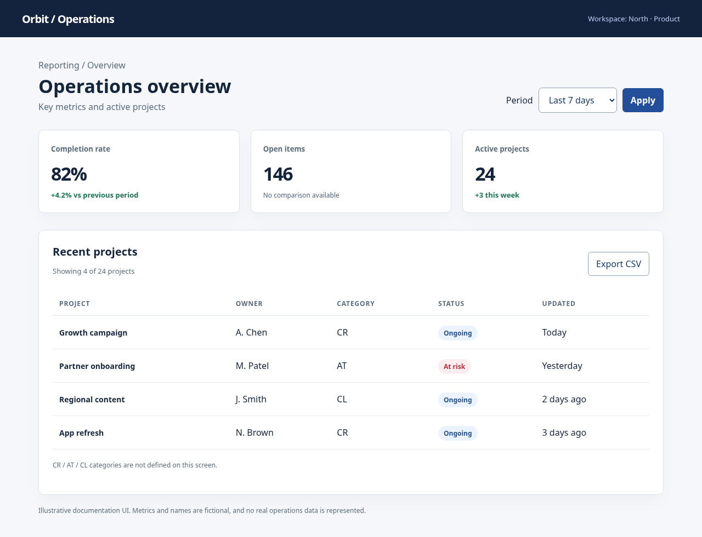

# UX Design Companion: User Guide

This guide explains how to use UX Design Companion to explore a design idea or review something you've already built.

You don't need to be a designer or know the UX frameworks by name. Start with what you're working on, who's using it and what's giving you trouble. The more context you can provide, the more useful the response is likely to be.

If you haven't set it up yet, start with [Installation](INSTALLATION.md).

## Contents

1. [When to use it](#1-when-to-use-it)
2. [Getting started](#2-getting-started)
3. [Create mode](#3-create-mode)
4. [Review mode](#4-review-mode)
5. [Choosing a review framework](#5-choosing-a-review-framework)
6. [Working with prototypes](#6-working-with-prototypes)
7. [Adding product context](#7-adding-product-context)
8. [Prompts to try](#8-prompts-to-try)
9. [What it can and can't check](#9-what-it-can-and-cant-check)
10. [FAQs](#10-faqs)

## 1. When to use it

There are two modes:

**Create** is for working out how a feature or screen should behave. You can compare approaches, talk through the trade-offs and ask for an HTML prototype.

**Review** is for getting feedback on an existing design. You can focus on usability, accessibility, visual design, information architecture or a user journey.

| If you're working on... | Try... |
| --- | --- |
| A new feature without a clear design | Create, with two approaches |
| A form that's difficult to complete | Review A (Usability) + E (User flow) |
| A screen with too much information | Review C (Visual design) |
| Confusing navigation | Review D (Information architecture) |
| Accessibility concerns | Review B (Accessibility) |
| A design you want to improve | Review, then ask for a revised prototype |

You don't have to go through every step. If you've already decided what you want, ask for a single prototype and move on from there.

## 2. Getting started

Open a project where you've installed the companion. Then ask it to work on a UX task. You can be fairly informal.

For example, to create something:

> Use UX Design Companion in Create mode. I'm working on sign-up for a mobile events app. I want the process to feel quick for first-time users. Show me two different ways it could work, with the drawbacks of each. Don't build anything yet.

Or to review something:

> Use UX Design Companion to review this dashboard screenshot. I'm mostly concerned about usability and visual hierarchy. What would you fix first?

Screenshots, HTML files, wireframes and an explanation of the current user journey are all helpful. If you don't have them, explain the problem as best you can. The companion should point out what it's assuming.

You can follow up in plain language: "Make this simpler", "Show me another approach", "Build the first option" or "Turn those findings into backlog tickets".

## 3. Create mode

Create mode usually follows this sequence:

1. Describe the problem and who you're designing for.
2. Look at the suggested approaches. By default, you should get two meaningfully different options, not just two colour schemes.
3. Choose one, build both, ask for different ideas or skip straight to the design you already have in mind.
4. Open the HTML prototype if your AI tool can save files.
5. Read the decision notes to understand the choices and trade-offs.
6. Ask for a revision. The previous version should be kept so you can compare them.

### Example: sign-up for an events app



*This screenshot comes from the HTML example included with the guide. It wasn't generated by an end-to-end test of the agent.*

Imagine you're designing registration for Gather, a fictional events app. You're not sure whether new users would prefer one page with all the fields or a shorter, two-step form.

Create mode is useful here because it lets you compare the approaches before committing to either. In the example, we choose the two-step form, with name and email first and password second. There's a Back button, progress feedback and basic validation.

You can [follow the Create walkthrough](examples/create-workflow.md) or [try the example HTML](examples/assets/signup-guided-demo.html). The file runs locally and doesn't create an account or send data anywhere.

**Tip:** Tell the companion what users need to achieve. "Help someone sign up without losing what they've entered" is more useful than "design a nice registration page".

## 4. Review mode

You can review a screenshot, HTML, code, a documented flow or a page your AI tool can open. Choose the type of feedback you want, or simply describe your concerns.

A useful review should tell you what material it examined, what seems to work, what needs improving and what evidence supports each finding. Where there's enough evidence, it can also give a score.

### Example: operations dashboard



*The dashboard and its data are fictional and were made for this guide.*

This dashboard shows three headline figures, a reporting-period filter and a projects table. Some elements are easy to understand at a glance. But the table uses short category codes like `CR`, `AT` and `CL` without explaining them.

You can see the unexplained codes in the screenshot. You can't tell from the image whether pressing Apply actually updates the data, or whether the page works properly with a keyboard.

The [Review walkthrough](examples/review-workflow.md) shows how to handle those differences, including an example of the scoring method.

## 5. Choosing a review framework

The companion has five review types. Use whichever are relevant. You don't need to run all five every time.

| Code | Framework | What it covers |
| --- | --- | --- |
| A | Usability | Nielsen's 10 heuristics, including status, consistency and error handling |
| B | Accessibility | Potential WCAG 2.2 AA barriers, including contrast, labels, focus and keyboard use |
| C | Visual design | Hierarchy, text, colour, spacing and layout |
| D | Information architecture | Navigation, grouping, labels and finding information |
| E | User flow | Task steps, friction, dead ends and recovery |

If you're reviewing a single screenshot, A and C are often a useful starting point. A full user-flow review needs enough information to see the journey, not just one screen.

### How scores work

Each framework is assessed against five dimensions. Each dimension gets **0**, **1**, **2** or **N/A**:

| Rating | Meaning |
| --- | --- |
| 0 | Significant problem |
| 1 | Some things work, but improvements are needed |
| 2 | Strong evidence of a good approach |
| N/A | Not enough information to judge |

The scores are scaled to a rating out of 10, based on the dimensions that could be assessed:

- **Five dimensions:** A full heuristic score.
- **Three or four:** A provisional score, with the coverage shown.
- **Two or fewer:** No numerical score.

The broad scale is 1 to 2 very poor, 3 to 4 poor, 5 to 6 adequate, 7 to 8 good and 9 to 10 excellent.

These are structured opinions, not usability-test results. If a finding looks doubtful, ask for the observations behind it. A good overall score also doesn't make an individual accessibility problem unimportant.

## 6. Working with prototypes

When your AI tool can write files, the companion usually saves work under `ux-companion/` in the project:

```text
ux-companion/
  prototypes/
    signup-guided.html
    signup-one-page.html
    signup-guided-v2.html
  decisions/
    signup-guided.md
    signup-one-page.md
  reviews/
    dashboard-review.md
```

The HTML files are prototypes you can open in a browser. The decision notes explain why a design was chosen and what still needs testing. Review files hold findings and suggested changes.

Once you have a prototype, don't just look at it. Click through the flow, deliberately make mistakes and try using it without a mouse. Use `Tab`, `Shift+Tab`, `Enter` and `Space`, and check it at mobile widths and high zoom.

When asking for a change, specify that the original should be kept:

> Keep the first sign-up prototype. Save a second version with clearer error messages and better mobile spacing. Explain what changed.

Some assistants can only return text. If no HTML file appears, ask for the code and save it yourself. Don't assume a file exists just because the assistant mentions a path.

## 7. Adding product context

The companion can work from a rough idea, but it will give better advice if it understands the product you're working on.

Useful things to provide include:

- Who the users are and what they're trying to do
- Screenshots, source files or existing flows
- A design system, component library or brand guidelines
- Known issues from research, analytics or support feedback
- Technical constraints, content rules and accessibility requirements

For example:

> We're using an existing component library, 8px spacing and navy primary buttons. Use those patterns rather than making up new ones. Keyboard access and screen-reader support are important.

The companion should use the supplied context rather than inventing an unrelated look and feel. Only share confidential material if you're authorised to use it with that AI service.

## 8. Prompts to try

**Explore a feature**

> Create mode. Returning users need to find their saved items on mobile. Suggest two approaches with the main trade-offs. Don't build anything yet.

**Build one option**

> Create mode. Build one responsive HTML checkout form using the attached wireframe. Include validation and explain the main decisions. Skip the second approach.

**Compare two options**

> Build both approaches as separate HTML files. Keep the original files and explain the differences in navigation and error handling.

**Review a journey**

> Review these three screenshots in order. Use A (Usability) and E (User flow). Focus on where someone might get stuck. Separate visible issues from assumptions.

**Check accessibility**

> Review this HTML for WCAG 2.2 AA issues. Tell me what you checked, what you couldn't check and what still needs manual testing.

**Make a revised design**

> Take the highest-priority issue from the review and prototype a fix. Keep the original and explain what you changed.

**Create backlog items**

> Turn these review findings into backlog items, with user impact, supporting evidence, a proposed fix and acceptance criteria. Flag anything we still need to validate.

## 9. What it can and can't check

Review findings are labelled as:

- **Observed:** Visible in the screenshot, present in the code or reproduced in a real interaction.
- **Inferred:** A possible issue based on the evidence, but not confirmed.
- **Needs testing:** Something that requires another check or more evidence.

For instance, a screenshot may show an unexplained button label. It won't show the keyboard focus order or whether a screen reader announces a form error. Even a code review can't cover every real-world accessibility concern.

The companion aims to produce prototypes that meet WCAG 2.2 AA, but generated code isn't proof of compliance. Browser checks, keyboard testing, assistive technology and human review are still important.

What the companion can do also depends on your AI tool. It may be able to open webpages and save files, or it may only be able to work with what you paste into chat. It should say what it actually checked.

## 10. FAQs

**Do I have to know UX terminology?** No. Explain the problem in your own words.

**Will it always give me two designs?** No. Two ideas are the default when you're exploring. You can ask for one, both or a completely different direction.

**Can I review just one screen?** Yes. A focused review is often more useful than a broad one.

**Why didn't it give me a score?** It needs evidence for at least three of the five dimensions before giving a numerical score.

**Does a good accessibility score mean the page is compliant?** No. Treat it as guidance on what to examine, not certification.

**Where did my prototype go?** Check the `ux-companion/prototypes/` folder. If it's not there, confirm the assistant can write files.

**How do I change the agent?** Edit [`src/agent.md`](../src/agent.md), run `python scripts/build.py` and then `python scripts/verify.py`.

**Can I use it outside Codex?** Yes. There are integrations for several tools, or you can paste the shared instructions into an assistant that supports custom instructions.

For setup help, see [Installation](INSTALLATION.md). For worked examples, see [Create](examples/create-workflow.md) and [Review](examples/review-workflow.md).
