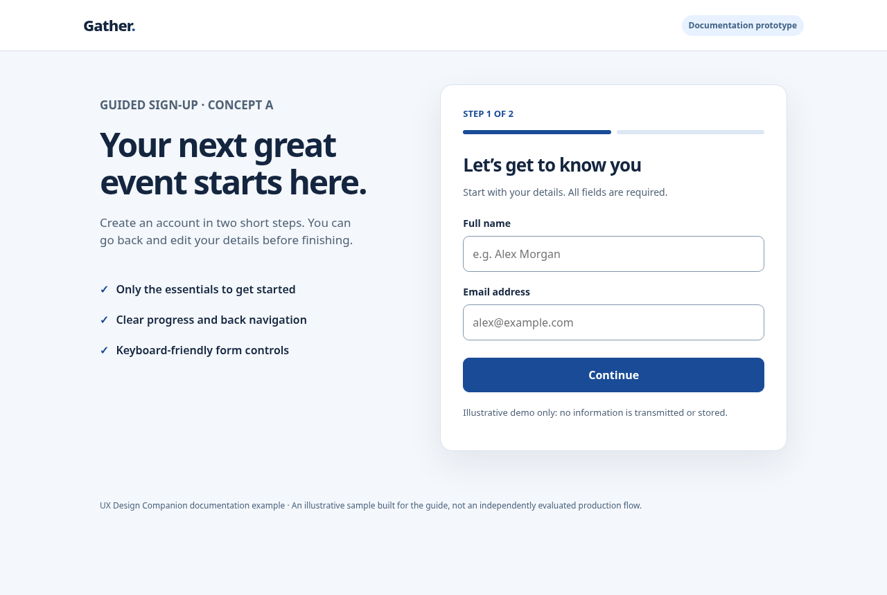

# Create example: Designing a sign-up flow

This walkthrough uses Gather, a fictional events app, to show what a Create conversation could look like. The HTML example and screenshot were made for this guide. They aren't the result of a live test of the agent.



[Open the example prototype](assets/signup-guided-demo.html) | [Back to the user guide](../USER-GUIDE.md#3-create-mode)

## The problem

Gather wants to make registration straightforward for first-time visitors. The team suspects the form is asking people to deal with too much at once, but hasn't tested that theory.

We want a couple of options to compare, not a claim that either design will increase sign-ups.

## 1. Ask for two approaches

> Use UX Design Companion in Create mode. I'm designing sign-up for a mobile events app called Gather. People should be able to register quickly and fix mistakes without starting again. Suggest two different approaches with pros and cons. Don't build anything until I've chosen one.

Here are two directions worth discussing:

| | Guided sign-up | One-page sign-up |
| --- | --- | --- |
| Approach | Name and email first, password on step two | All fields on one screen |
| Advantage | Fewer fields to deal with at once | No extra screen to navigate |
| Drawback | Extra step and more state to manage | A longer form may feel less approachable |
| Accessibility points | Focus management, step progress and Back behaviour | Clear labels, error messages and small-screen layout |
| What to test | Does breaking it up reduce errors? | Is one page faster to complete? |

For the example, we'll choose the guided version.

## 2. Ask for a prototype

> Build the guided option as a single HTML file. Include name, email and password fields, a progress indicator, Back navigation and field-level errors. Keep what I've entered when I go back. Save the design decisions. Don't send form data anywhere.

The [example HTML](assets/signup-guided-demo.html) has two steps, basic validation and a confirmation state. It runs in a browser without a server. Nothing is submitted to a real account system.

## 3. Test the example

1. Open the HTML file in a browser and press Continue with both fields blank.
2. Enter a name and email, then continue.
3. Use Back and check that your details are still there.
4. Go forward and try a password shorter than 12 characters.
5. Enter a longer password and submit. The example should show a local confirmation screen.

Try navigating with the keyboard too. A working demo is only the start of testing.

## 4. Read the design notes

The companion should save a short explanation with the prototype. For this example, it could include:

**Decision:** Use two steps with a visible progress indicator and Back navigation.

**Why:** There are fewer fields on screen at once, and users can return to fix an earlier entry.

**Trade-off:** More steps could slow people down. We don't know whether it improves completion without testing it.

**To check:** Completion and error rates, time to register, focus management, screen-reader announcements and small-screen behaviour.

In a project with file access, the output might look like this:

```text
ux-companion/
  prototypes/gather-guided-signup.html
  decisions/gather-guided-signup.md
```

These are example paths. The supplied demo is in `docs/examples/assets/`.

## 5. Ask for a change

> Keep the first prototype. Create `gather-guided-signup-v2.html` with better field-level errors and more space around controls on mobile. Add a short note explaining the changes.

Now you have two versions to compare. Check the revised flow in a browser rather than assuming the change is an improvement. A prototype doesn't establish usability or WCAG compliance on its own.
