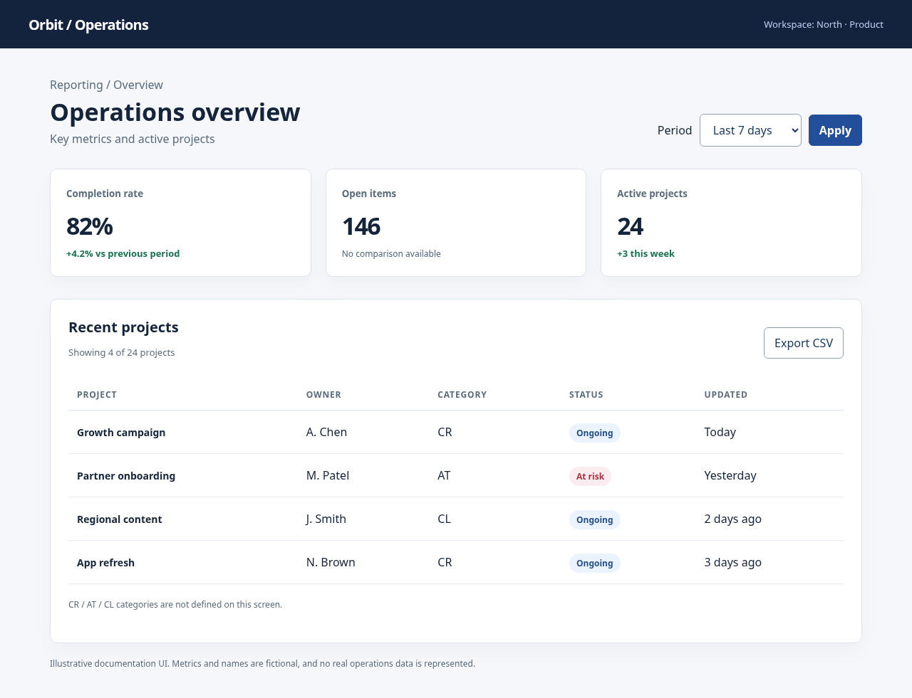

# Review example: An operations dashboard

This walkthrough shows what you can learn from a screenshot, and where a screenshot isn't enough. The dashboard and all its data are fictional. The findings are examples, not the output of a live agent review.

[Open the dashboard HTML](assets/dashboard-review-demo.html) | [Back to the user guide](../USER-GUIDE.md#4-review-mode)

## The problem

A team wants feedback on its weekly operations dashboard. It has headline metrics, a reporting-period selector, an Apply button and a table of recent projects.

The main questions are whether people can scan the information easily and whether the labels make sense.

## 1. Ask for a review

> Use UX Design Companion to review this dashboard screenshot. Focus on A (Usability), C (Visual design) and D (Information architecture). Separate things you can see from assumptions and things that need testing. Only give scores where there's enough evidence. Tell me what to fix first.

## 2. Look at the findings

A review could identify the following:

| Evidence | Finding | What to do |
| --- | --- | --- |
| **Observed** | The project table uses `CR`, `AT` and `CL` without explaining the codes. | Use full names or explain the codes. |
| **Observed** | The main figures are easy to find near the top of the page. | Keep that part of the hierarchy. |
| **Inferred** | Users may not realise whether a new reporting period has been applied. | Make the active period and update state clearer. |
| **Needs testing** | The image can't tell us whether Apply works with a keyboard or announces changes to screen readers. | Test the live page. |
| **Needs testing** | One desktop image doesn't tell us how the table behaves on a phone. | Check smaller widths and zoom. |

The evidence labels matter. We can see the category codes, but we haven't proved that they cause mistakes. We'd need to speak to users or observe them completing tasks to know that.

## 3. Understand the score

Usability is assessed against five dimensions. From this screenshot, only three may have enough evidence to score:

| Dimension | Example rating | Reason |
| --- | --- | --- |
| Feedback and status | N/A | Can't confirm what Apply does |
| Real-world language and conventions | 1/2 | Category codes aren't explained |
| Control and recovery | N/A | No interaction has been tested |
| Recognition and efficiency | 1/2 | Users have to remember what the codes mean |
| Clarity and error prevention | 1/2 | Clear general layout, but ambiguous labels |

That's **3 points from 6 available**, giving a **provisional score of 5/10**, with three of the five dimensions assessed.

This is an illustration of the scoring calculation, not a measured usability rating. Visual design and information architecture would be scored separately if there was enough evidence.

## 4. Decide what to fix

I'd start by replacing the unexplained category codes. It's a fairly small change and makes the table easier to interpret. Next I'd make the selected reporting period more obvious. Then I'd test keyboard behaviour and the smaller-screen layout.

To move from feedback to a working comparison, ask:

> Create a revised dashboard prototype with clearer category labels and better feedback when I apply a reporting period. Keep the original and explain the differences. Also list the accessibility checks that still need doing.

The revised prototype would still need to be checked by a person. A screenshot review can suggest a direction, but it can't confirm how the real product behaves.
